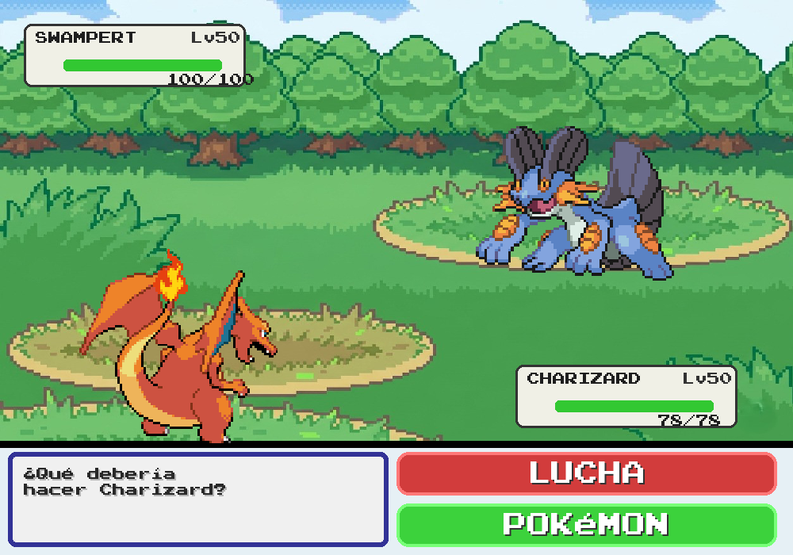
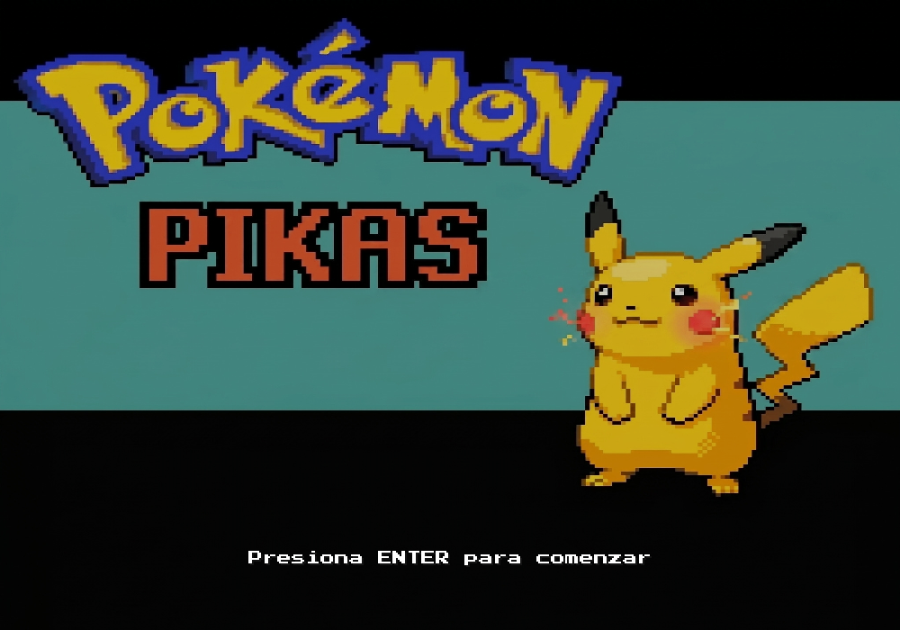

# PokePikas — Simulador de combates Pokémon con IA

[](https://www.python.org/)
[](https://www.pygame.org/)
[](LICENSE)
[](https://github.com/tejedasebastian/PokePikas/actions/workflows/smoke.yml)



PokePikas es un simulador de batallas Pokémon por turnos escrito en Python con
Pygame. Incluye un motor de combate, cinco agentes de inteligencia artificial
(aleatorio, heurístico, Minimax con poda alfa-beta y algoritmo genético) y una
interfaz gráfica con modo historia tipo «Alto Mando». El proyecto funciona como
una plataforma reproducible para experimentar con búsqueda adversarial,
optimización evolutiva y evaluación de estados.

> **Proyecto no oficial.** No está afiliado, patrocinado ni respaldado por
> Nintendo, Game Freak, Creatures Inc. o The Pokémon Company. Los nombres,
> personajes, sprites y música pertenecen a sus respectivos titulares y **no**
> se relicencian bajo la licencia del código. Consulta [`NOTICE`](NOTICE).

---

## Tabla de contenidos

1. [Características](#1-características)
2. [Requisitos e instalación](#2-requisitos-e-instalación)
3. [Instalación y ejecución](#3-instalación-y-ejecución)
4. [Modos de juego](#4-modos-de-juego)
5. [Estructura del proyecto](#5-estructura-del-proyecto)
6. [Arquitectura](#6-arquitectura)
7. [Modelo de combate](#7-modelo-de-combate)
8. [Agentes de inteligencia artificial](#8-agentes-de-inteligencia-artificial)
9. [Heurísticas y algoritmo genético](#9-heurísticas-y-algoritmo-genético)
10. [Interfaz gráfica](#10-interfaz-gráfica)
11. [Simulaciones y benchmarks](#11-simulaciones-y-benchmarks)
12. [Tests y CI](#12-tests-y-ci)
13. [Datos y persistencia](#13-datos-y-persistencia)
14. [Reproducibilidad](#14-reproducibilidad)
15. [Limitaciones](#15-limitaciones)
16. [Licencia y derechos](#16-licencia-y-derechos)

---

## 1. Características

- **30 Pokémon** con 8 movimientos modelados cada uno y **95 movimientos** en el
  catálogo, cargados desde JSON versionados.
- **Batallas 3v3 y 4v4** con orden por velocidad, cambios, estados alterados y
  tabla completa de efectividades de tipos.
- **Cinco niveles de IA**: línea base aleatoria, heurística greedy, Minimax con
  poda alfa-beta en dos variantes y pesos evolucionados por algoritmo genético.
- **Modo Alto Mando** con cinco salas consecutivas (L1 → L5), conservación del HP
  entre batallas y salón de la fama.
- **Interfaz Pygame** con menús, sprites, música, efectos elementales y
  animaciones de combate.
- **Simulaciones headless** paralelizadas para comparar agentes y reproducir
  experimentos con semillas fijas.
- **Smoke test y CI** que validan datos, agentes, una batalla completa y la
  ejecución del torneo en Python 3.11 y 3.12.

## 2. Requisitos e instalación

### 2.1 Requisitos

| Componente | Versión / nota |
|---|---|
| Python | **3.11 o superior** (probado en 3.11.9 y 3.12; CI cubre ambas) |
| Pygame | `2.6.1` (fijado en `requirements.txt`) |
| Audio | Opcional; el juego continúa si Pygame no puede inicializar el mezclador |
| Sistema | Windows, Linux o macOS con entorno gráfico para la GUI |

El target es **Python 3.11+** porque el código usa anotaciones modernas
(`int | None`, `list[...]`) y el benchmark contiene f-strings que no compilan en
Python 3.10/3.11 con comillas anidadas del mismo tipo. No se recomienda usar
versiones anteriores.

### 2.2 Instalación

```bash
git clone https://github.com/tejedasebastian/PokePikas.git
cd PokePikas
python -m venv .venv

# Windows (PowerShell)
.venv\Scripts\Activate.ps1
# Linux / macOS
source .venv/bin/activate

pip install -r requirements.txt
```

Los datos (`pokemon_pool.json`, `moves_pool.json` y `level5_weights.json`) ya
están versionados en `data/`, por lo que el proyecto funciona sin conexión a
internet. No se necesita ninguna clave de API.

## 3. Instalación y ejecución

### 3.1 Interfaz gráfica

Desde la raíz del repositorio (los assets se resuelven con rutas relativas):

```bash
python main.py
```

También se puede abrir directamente el menú:

```bash
python src/gui/menu.py
```

Controles habituales: ratón para menús y acciones, `ENTER` para comenzar,
`ESPACIO` para avanzar diálogos y `ESC` para volver o salir de una batalla.

### 3.2 Simulaciones headless (sin ventana)

```bash
python simulate_ai_4.py                    # Matriz competitiva L1-L4 (3v3 y 4v4)
python simulate_ai_5.py                    # Torneo L5 vs L1-L4
python benchmark_l4_vs_l5.py               # Benchmark directo L4 vs L5 con IC 95 %
python depth_sweep.py                      # Barrido de profundidad de L3/L4
```

Opciones comunes: `--n` (batallas por par), `--size 3|4|both` y `--cores N`.
Ejemplo rápido y determinista:

```bash
python simulate_ai_5.py --n 1 --size 3 --cores 1
```

`depth_sweep.py` acepta además `--l3-depths` y `--l4-depths` para acotar las
profundidades evaluadas.

## 4. Modos de juego

| Modo | Descripción | IA involucrada |
|---|---|---|
| **Humano vs PC** | El jugador controla un equipo y la máquina el rival. | L1 a L5 elegible. |
| **PC vs PC** | Simulación automática entre dos IAs seleccionables. | L1 a L5 para ambos lados. |
| **Alto Mando** | Historia de cinco salas consecutivas. El equipo conserva HP y estados; entre batallas se cura y se restauran PP. | L1, L2, L3, L4 y L5 fijas por sala. |

La dificultad se elige con 1 a 5 estrellas, que mapean a `Level1Agent` …
`Level5Agent`.

## 5. Estructura del proyecto

```text
PokePikas/
├── main.py                       # Entry point gráfico
├── config.py                     # FACTOR_K, profundidades de Minimax, INF
├── requirements.txt
├── simulate_ai_4.py              # Matriz L1-L4 (3v3 y 4v4)
├── simulate_ai_5.py              # Torneo L5 contra L1-L4
├── benchmark_l4_vs_l5.py         # Benchmark directo L4 vs L5 con IC 95 %
├── depth_sweep.py                # Barrido de profundidad L3/L4 vs L2
├── tests/
│   └── smoke_test.py             # Smoke test headless (datos + agentes + batalla)
├── .github/
│   └── workflows/smoke.yml       # CI: Python 3.11/3.12, compileall y torneo 3v3
├── docs/
│   ├── screenshot_battle.png     # Captura real del juego
│   └── screenshot_menu.png
├── LICENSE                       # MIT para el código
├── NOTICE                        # Derechos de assets y marcas de terceros
├── src/
│   ├── core/
│   │   ├── battle_engine.py      # process_turn, orden de turno, daño residual
│   │   ├── damage_calc.py        # Fórmula de daño, type chart, stat stages
│   │   └── interfaces.py         # BattleState, Action, MoveState, PokemonState
│   ├── entities/
│   │   ├── pokemon.py            # Pokemon (HP, stats, stages, to_state/from_state)
│   │   ├── move.py               # Move (poder, precisión, PP, ailment, drain...)
│   │   └── enums.py              # PokemonType, AilmentType
│   ├── ai/
│   │   ├── base_agent.py         # Interfaz ABC para todos los agentes
│   │   ├── level1_agent.py       # Baseline aleatorio
│   │   ├── level2_agent.py       # Heurística greedy (diferencia de HP)
│   │   ├── level3_agent.py       # Minimax + alfa-beta con heurística simple
│   │   ├── level4_agent.py       # Minimax + alfa-beta con heurística compuesta
│   │   ├── level5_agent.py       # L4 con pesos evolucionados por AG
│   │   ├── heuristics.py         # Funciones de evaluación puras
│   │   └── genetic_algo.py       # Algoritmo genético (elitismo, torneo, BLX-α)
│   ├── gui/
│   │   ├── menu.py               # Menú principal y selección de modo/equipo
│   │   ├── battle_ui.py          # BattleScreen: sprites, HP, animaciones, diálogos
│   │   ├── league_room.py        # Modo Alto Mando (exploración 2D + batallas)
│   │   └── renderer.py           # Helpers de dibujo y carga de sprites
│   └── utils/
│       ├── data_loader.py        # Carga JSON y crea equipos
│       └── move_registry.py      # DataLoader singleton por proceso
├── data/
│   ├── pokemon_pool.json         # 30 Pokémon con stats y move_ids
│   ├── moves_pool.json           # 95 movimientos modelados
│   └── ai/
│       └── level5_weights.json   # Pesos evolucionados consumidos por L5
└── assets/                       # Sprites, fondos, música, efectos y fuente
```

El log de entrenamiento `data/ai/level5_ga.log` se genera localmente al ejecutar
el algoritmo genético y está ignorado por Git.

## 6. Arquitectura

El sistema se organiza en cinco capas:

```text
┌──────────────────────────────────────────────────────┐
│ Presentación   src/gui  (Pygame)                     │
├──────────────────────────────────────────────────────┤
│ IA             src/ai   (5 agentes + AG)             │
├──────────────────────────────────────────────────────┤
│ Core           src/core (motor + interfaces)         │
├──────────────────────────────────────────────────────┤
│ Entidades      src/entities                          │
├──────────────────────────────────────────────────────┤
│ Datos          src/utils + data/*.json               │
└──────────────────────────────────────────────────────┘
```

- **Datos**: JSON locales y `DataLoader` cacheado con `lru_cache(maxsize=1)` por
  proceso, también en cada worker de `multiprocessing`.
- **Entidades**: modelo de dominio (`Pokemon`, `Move`, enums).
- **Core**: motor de batalla, fórmula de daño y estructuras de estado.
- **IA**: agentes de decisión, heurísticas y optimizador genético.
- **Presentación**: render, eventos, animaciones y transiciones.

La GUI y los scripts headless comparten exactamente el mismo motor y los mismos
agentes; la simulación no depende de Pygame.

## 7. Modelo de combate

### 7.1 Atributos

Cada Pokémon tiene `max_hp`, `attack`, `defense`, `special_attack`,
`special_defense`, `speed`, uno o dos tipos, cuatro movimientos seleccionados al
azar de su pool de ocho, `stat_stages` (-6 a +6) y `status_ailment`.

### 7.2 Fórmula de daño

Implementada en `src/core/damage_calc.py`:

```python
base_damage = ((atk / max(1, dfe)) * move_power) / 3.5
speed_factor = defender_spd * FACTOR_K    # FACTOR_K = 0.0 en config.py
raw_damage   = base_damage - speed_factor
final_damage = max(1, raw_damage * type_multiplier)
```

- `atk` y `dfe` ya incluyen modificadores por `stat_stages` y por alteraciones
  (parálisis reduce velocidad, quemadura reduce ataque).
- `type_multiplier` proviene de `TYPE_CHART` (18 × 18 tipos).
- `FACTOR_K = 0.0` desactiva el término de esquiva de la fórmula original; es una
  decisión de balance para que la evaluación de la IA sea consistente.
- El divisor `3.5` es una calibración propia para evitar one-shots y mantener
  batallas de duración razonable. **No replica la fórmula oficial de Pokémon.**

### 7.3 Resolución de turnos (`process_turn`)

1. Determina el orden por velocidad.
2. Aplica los cambios primero y reinicia `stat_stages` del Pokémon que entra.
3. Aplica cada movimiento: PP, sueño/congelación, parálisis, precisión, tipo,
   daño, drenaje, retroceso, probabilidad de alteración y multi-golpe (id 594).
4. Aplica daño residual al final del turno (quemadura, veneno, drenadoras).
5. Detecta KOs y promueve automáticamente al siguiente Pokémon vivo.

Los movimientos de prioridad, habilidades, objetos, clima y terreno **no** están
modelados.

### 7.4 Estados alterados

`NONE`, `BURN`, `POISON`, `PARALYSIS`, `SLEEP`, `FREEZE`, `CONFUSION`,
`LEECH_SEED` y `SILENCE`, definidos en `src/entities/enums.py`.

## 8. Agentes de inteligencia artificial

Todos implementan `BaseAgent.get_action(state) -> Action`.

| Nivel | Clase | Estrategia | Profundidad |
|---|---|---|---|
| **L1** | `Level1Agent` | Selección uniforme entre acciones legales. | — |
| **L2** | `Level2Agent` | Greedy: maximiza `my_hp − (opp_hp − daño_estimado)`, estimando daño con stats y tipos. | 1 |
| **L3** | `Level3Agent` | Minimax con alfa-beta y heurística de diferencia absoluta de HP. | 2 (`AI_LEVEL3_DEPTH`) |
| **L4** | `Level4Agent` | Minimax con alfa-beta y heurística compuesta normalizada (HP, vivos, tipo, velocidad, estado); acciones preordenadas por score. | 3 (`AI_LEVEL4_DEPTH`) |
| **L5** | `Level5Agent` | Igual que L4, pero con pesos evolucionados por el algoritmo genético. | 3 |

Las profundidades se configuran en `config.py` sin tocar el código de los
agentes. Aumentarlas mejora la búsqueda pero encarece cada decisión de forma
exponencial.

## 9. Heurísticas y algoritmo genético

### 9.1 Heurísticas

| Función | Uso | Factores |
|---|---|---|
| `calculate_hp_differential_l3` | L3 (hojas y estados terminales). | Σ HP propio − Σ HP rival. |
| `evaluate_level4_state` | Hojas de L4 y L5. | HP, vivos, tipo, velocidad y estado, todos en [-1, 1]. |
| `_evaluate_state` (L5) | Suma ponderada de los cinco factores. | Pesos de `data/ai/level5_weights.json`. |

Los factores se normalizan con `_clamp` y divisiones por `max_hp` o el tamaño del
equipo.

### 9.2 Algoritmo genético

Configuración por defecto en `GeneticConfig`:

- **Población**: 40 individuos; **élite**: 4.
- **Selección**: torneo de tamaño 5.
- **Cruce**: BLX-α con α = 0.25.
- **Mutación**: gaussiana, tasa 0.15 y fuerza 0.20, con *annealing* ante
  estancamiento.
- **Fitness**: 65 % resultado, 15 % HP residual, 10 % Pokémon vivos y 10 %
  velocidad de victoria.
- **Dos fases**: se reevalúa el **35 % superior** con `battles_phase2=8`; un
  holdout de 8 escenarios contra `Level4Agent` mide generalización.
- **Paralelización**: `multiprocessing.Pool` con `cpu_count() − 1` workers por
  defecto.
- **PRNG anclado**: la semilla se deriva de generación, escenario y batalla para
  comparar candidatos con las mismas condiciones.
- **Paro**: 15 generaciones sin mejora o 50 generaciones.

Pesos versionados de la última corrida (`data/ai/level5_weights.json`, generación
28):

| Factor | Valor |
|---|---|
| `hp` | 1.2708 |
| `alive` | 0.9711 |
| `type` | 0.5330 |
| `speed` | 0.1077 |
| `status` | 0.0692 |

Los pesos favorecen HP y Pokémon vivos; tipo aporta un ajuste táctico moderado y
velocidad/estado quedan casi anulados. Son el resultado de una corrida concreta,
no una garantía de superioridad estadística.

### 9.3 Reentrenar los pesos

```bash
python -m src.ai.genetic_algo
```

Para cambiar hiperparámetros desde código:

```bash
python -c "from src.ai.genetic_algo import run_genetic_algorithm, GeneticConfig; \
  cfg = GeneticConfig(max_generations=80, population_size=60, patience=20, seed=42); \
  run_genetic_algorithm(cfg)"
```

El entrenamiento es **costoso**: el log de la última corrida muestra alrededor de
13 minutos por generación con 15 núcleos, por lo que una ejecución completa puede
durar horas. El resultado se guarda en `data/ai/level5_weights.json` y el log en
`data/ai/level5_ga.log` (ignorado por Git).

## 10. Interfaz gráfica

| Menú principal | Combate |
|---|---|
|  |  |

- **`menu.py`**: máquina de estados (`START`, `MODE_SELECT`, `TEAM_SELECT`,
  `DIFFICULTY_SELECT`, `BATTLE`, `LEAGUE`) con render condicional.
- **`battle_ui.py`** (`BattleScreen`): pantalla dividida tipo DS (80 % combate,
  20 % diálogo/acciones), barras de HP interpoladas, sprites frontales y traseros,
  animaciones de daño, debilitamiento, cambio y ataques elementales, y la
  transformación especial de Greninja-Ash.
- **`league_room.py`**: exploración 2D del Alto Mando con sprite animado y
  transición automática a la batalla conservando el HP del equipo.
- **`renderer.py`**: utilidades de dibujo de texto, botones, barras, sprites y
  cuadrículas.

Assets incluidos: 30 sprites de combate frontales y 31 traseros (incluye la
variante base de Greninja-Ash), retratos de NPC y elementos de interfaz, siete
fondos, cinco efectos elementales, tres pistas de música y un efecto de selección.

## 11. Simulaciones y benchmarks

| Script | Función | Salida |
|---|---|---|
| `simulate_ai_4.py` | Matriz L1-L2, L1-L3, L1-L4, L2-L3, L2-L4 y L3-L4. | Win rate, empates, turnos y tiempo. |
| `simulate_ai_5.py` | Torneo L5 contra L1, L2, L3 y L4. | Win rate L5, HP restante, vivos y turnos. |
| `benchmark_l4_vs_l5.py` | Comparación directa L4 vs L5. | Win rate L5, IC 95 % (Wilson) y desglose P1/P2. |
| `depth_sweep.py` | Barrido de profundidades de L3/L4 contra L2. | Win rate, turnos y ms/batalla. |

Las simulaciones paralelizan con `multiprocessing.Pool` y alternan la perspectiva
P1/P2 en cada batalla para reducir el sesgo de orden de turno. No se incluyen
resultados agregados en el repositorio: se generan al ejecutar los scripts.

El benchmark L4 vs L5 es caro para muestras grandes (alrededor de 8 segundos por
batalla 4v4 en un núcleo). La CI ejecuta solo `--n 1` como smoke de ejecución,
sin pretender significancia estadística; para analizar resultados usa una muestra
grande:

```bash
python benchmark_l4_vs_l5.py --n 200 --cores 8
```

## 12. Tests y CI

El smoke test headless no abre ventanas y comprueba:

1. Que los JSON cargan con 30 Pokémon y 95 movimientos, y que todas las
   referencias de movimientos existen.
2. Que los cinco agentes devuelven una `Action` válida sobre un estado real.
3. Que una batalla 3v3 completa (L5 vs L1) termina por KO dentro de 120 turnos y
   que el equipo perdedor queda debilitado.
4. Que `benchmark_l4_vs_l5.py` arranca y completa una batalla 4v4 (`--n 1`).

```bash
python -m compileall -q .
python tests/smoke_test.py
python simulate_ai_5.py --n 1 --size 3 --cores 1
python benchmark_l4_vs_l5.py --n 1 --cores 1
```

El workflow [`.github/workflows/smoke.yml`](.github/workflows/smoke.yml) ejecuta
esos cuatro pasos en `ubuntu-latest` con Python **3.11** y **3.12** en cada push a
`main`, en pull requests y de forma manual. La GUI no se prueba en CI porque
requiere un servidor gráfico; las capturas de `docs/` se generaron localmente con
`SDL_VIDEODRIVER=dummy` y el propio render de Pygame.

## 13. Datos y persistencia

| Archivo | Contenido | Origen |
|---|---|---|
| `data/pokemon_pool.json` | 30 Pokémon con stats base y pool de `move_ids`. | Snapshot derivado de PokéAPI, versionado. |
| `data/moves_pool.json` | 95 movimientos con todos sus atributos. | Snapshot derivado de PokéAPI, versionado. |
| `data/ai/level5_weights.json` | Pesos evolucionados que consume L5. | `genetic_algo.py`. |
| `data/ai/level5_ga.log` | Log del entrenamiento. | `genetic_algo.py`; local e ignorado por Git. |

El script de descarga original **no está incluido** en este repositorio. Los
JSON versionados son la fuente de verdad y permiten ejecutar el proyecto sin
red. Si se regeneran datos desde PokéAPI, hay que respetar sus términos de uso.

`src/utils/move_registry.py` mantiene un singleton de `DataLoader` por proceso
para evitar lecturas repetidas del JSON, tanto en el proceso principal como en
los workers de `multiprocessing`.

## 14. Reproducibilidad

- **Semillas deterministas**: `simulate_ai_*.py` fijan `random.seed` con la
  semilla recibida, de modo que dos ejecuciones con la misma semilla producen los
  mismos resultados.
- **PRNG anclado en AG**: las batallas de fitness usan
  `generation_seed * 100000 + scenario_id * 1000 + battle_idx * 2`.
- **Datos versionados**: no se necesita PokéAPI ni conexión a internet.
- **Versiones fijadas**: `pygame==2.6.1` y Python 3.11+.
- **CI**: compileall, smoke test, torneo 3v3 y benchmark de una batalla en dos
  versiones de Python.

Para reproducir la suite completa (puede tardar bastante):

```bash
python simulate_ai_4.py --n 200 --size both
python simulate_ai_5.py --n 200 --size both
python benchmark_l4_vs_l5.py --n 500
```

## 15. Limitaciones

- **Mecánicas simplificadas**: no hay habilidades, objetos, clima, terreno,
  prioridad de movimientos ni estados volátiles complejos. La fórmula de daño es
  propia y no replica la de los juegos oficiales.
- **Contenido acotado**: 30 especies, 95 movimientos, equipos de 3 o 4 Pokémon y
  cuatro movimientos aleatorios por Pokémon.
- **IA acotada**: Minimax llega a profundidad 3 y no es una búsqueda exhaustiva.
  L5 no garantiza mejorar a L4 en todos los emparejamientos; los pesos pueden
  sobreajustarse al conjunto de evaluación.
- **Entrenamiento caro**: el AG puede tardar horas y está pensado para ejecutarse
  manualmente, no en CI.
- **GUI**: resolución fija de 1000 × 700, textos en español y sin guardado de
  partida, multijugador en red ni gamepad. Requiere ejecutar desde la raíz para
  resolver los assets relativos.
- **Cobertura de tests**: la CI valida el motor y los agentes en headless, pero no
  prueba renderizado, audio ni interacción de la GUI.
- **Derechos de assets**: los sprites y la música son de terceros; el proyecto no
  es oficial y no debe presentarse como tal.

## 16. Licencia y derechos

El **código fuente** se distribuye bajo la licencia **MIT**; consulta
[`LICENSE`](LICENSE).

Los **sprites, retratos, fondos, música, nombres y personajes de Pokémon** no
están cubiertos por la licencia MIT y siguen perteneciendo a sus respectivos
titulares. Se incluyen únicamente con fines educativos y de demostración. Consulta
[`NOTICE`](NOTICE) para el detalle. Si eres titular de derechos y deseas que se
retire algún asset, abre un issue en el repositorio.

Este es un proyecto personal y **no oficial**; no está afiliado, patrocinado ni
aprobado por Nintendo, Game Freak, Creatures Inc. o The Pokémon Company.

### Referencias

- [PokéAPI](https://pokeapi.co/) — origen de los datos de Pokémon y movimientos.
- [Pygame](https://www.pygame.org/) — renderizado y audio.
- [Pokémon Showdown](https://pokemonshowdown.com/) — referencia mecánica.
- Repositorio: <https://github.com/tejedasebastian/PokePikas>
